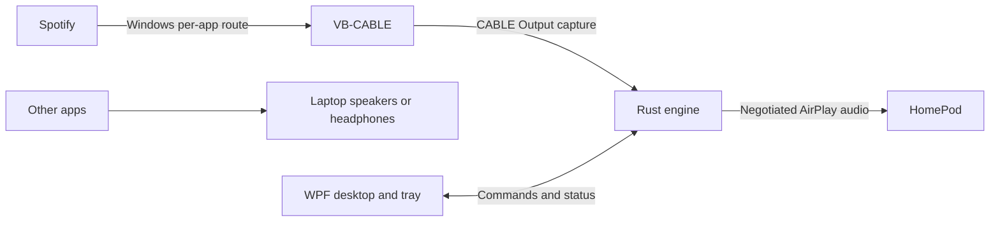

# Architecture

## Required behavior

One full-size HomePod receives Spotify music. Spotify stays silent locally; notifications and other apps keep the normal laptop output. Keep Spotify as the player. Favor stable music playback over low latency.

## Boundaries

| Component | Responsibility |
|---|---|
| C#/.NET 10/WPF | Receiver/source selection, tray controls, state and settings |
| Rust/WASAPI | Continuous capture, bounded buffering, conversion and sender session |
| AirFlash candidate | Source-built transport foundation; pin and qualify before relying on it |
| Windows DNS-SD | Receiver discovery with persistent identity |
| JSONL child-process IPC | Versioned commands/events; no PCM through the UI |
| JSON and DPAPI | Atomic preferences and user-bound pairing credentials |

Spotify sends to **CABLE Input**, the app captures **CABLE Output**. Keep the normal default output unchanged and cable monitoring disabled. Process capture alone does not suppress local playback. Manual per-app routing is acceptable initially; Disconnect must explain routing that remains active.

Missing source means waiting/error, never whole-system or microphone fallback. Disconnect cancels reconnect. Recover to current live audio, not accumulated backlog. Separate requested, negotiated and applied state.

## Qualification and scope

First qualify pinned AirFlash source against the actual HomePod. The saved baseline is `v0.4.0`; verify its full revision and review any required updates. Preserve upstream licenses and provenance. Record alternatives only when a demonstrated blocker justifies them.

No stereo grouping, multiroom, EQ, video synchronization or Spotify API integration in version 1. No acoustic latency claim without measurement. The [static investigation](../research/README.md) informs the design but proves neither streaming success nor receiver compatibility.

## Qualification implementation

The imported AirFlash v0.4.0 revision is
`81fa26bab0d5b42acaa4e5a5953ed05ae26e6350`; its layout remains under `src/AirFlash/`.
Internal namespaces remain AirFlash, with PodCast assembly, tray, single-instance,
sender and storage identities. Existing upstream advanced internals remain to
avoid destabilizing transport; group connection is rejected and EQ defaults off.

Native capture requires an explicit MMDevice ID for an active recording endpoint
named `CABLE Output (VB-Audio Virtual Cable)`. It validates and opens that device
before receiver contact. Missing/changed sources fail without fallback. The
existing JSONL `source: loopback` value remains for IPC compatibility, although
this source uses direct recording capture without the WASAPI loopback flag.
Physical-output muting is disabled. The inherited bounded PCM queue and session
cancellation/generation checks remain in use.

Preferences use atomic JSON in `%APPDATA%/PodCast`. Pairing material uses separate
PodCast DPAPI entropy and storage; missing APPDATA fails. Desktop diagnostics are
redacted and retain two files of at most 256 KiB each. IPC input/output is bounded
before allocating an entire line. PCM stays outside the command channel.

Office took about five seconds to answer `/pair-pin-start` after `/info` on the
same connection. That request now has a ten-second deadline, restoring the normal
four-second control deadline on success or failure. Cancellation remains active.
This resolves the observed authentication timeout. Finite synthetic probes remain limited to five seconds, raw
peak 0.5 and gain 0.1 (effective peak at most 0.05); defaults retain the original
quieter stimulus. Probes reject capture, recording, grouping and multiple hosts.

The optional `source_peak` metric measures the latest input packet before EQ or
gain and resets on silence/underrun. The playback panel and Monitor display its
activity separately from receiver state. Missing/invalid metrics show waiting;
input activity is not proof of audible playback. Progress bars bind OneWay to
derived properties. `--ui-smoke --window-only` checks both window constructions
without discovery, capture or receiver access.
