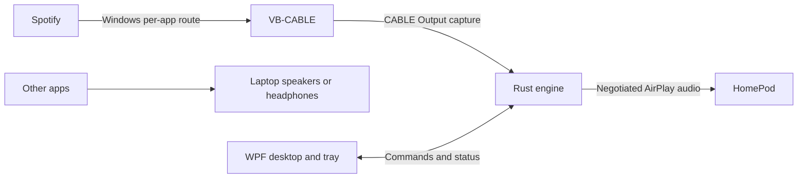

# Architecture

## Required behavior

One full-size HomePod receives Spotify music. Spotify stays silent locally; notifications and other apps keep the normal laptop output. Keep Spotify as the player. Favor stable music playback over low latency.

## Boundaries

| Component | Responsibility |
|---|---|
| C#/.NET 10/WPF | Receiver/source selection, tray controls, state and settings |
| Rust/WASAPI | Continuous capture, bounded buffering, conversion and sender session |
| AirFlash candidate | Source-built transport foundation; pin and qualify before relying on it |
| Windows DNS-SD | Receiver discovery with persistent identity |
| JSONL child-process IPC | Versioned commands/events; no PCM through the UI |
| JSON and DPAPI | Atomic preferences and user-bound pairing credentials |

Spotify sends to **CABLE Input**, the app captures **CABLE Output**. Keep the normal default output unchanged and cable monitoring disabled. Process capture alone does not suppress local playback. Manual per-app routing is acceptable initially; Disconnect must explain routing that remains active.

Missing source means waiting/error, never whole-system or microphone fallback. Disconnect cancels reconnect. Recover to current live audio, not accumulated backlog. Separate requested, negotiated and applied state.

## Qualification and scope

First qualify pinned AirFlash source against the actual HomePod. The saved baseline is `v0.4.0`; verify its full revision and review any required updates. Preserve upstream licenses and provenance. Record alternatives only when a demonstrated blocker justifies them.

No stereo grouping, multiroom, EQ, video synchronization or Spotify API integration in version 1. No acoustic latency claim without measurement. The [static investigation](../research/README.md) informs the design but proves neither streaming success nor receiver compatibility.
