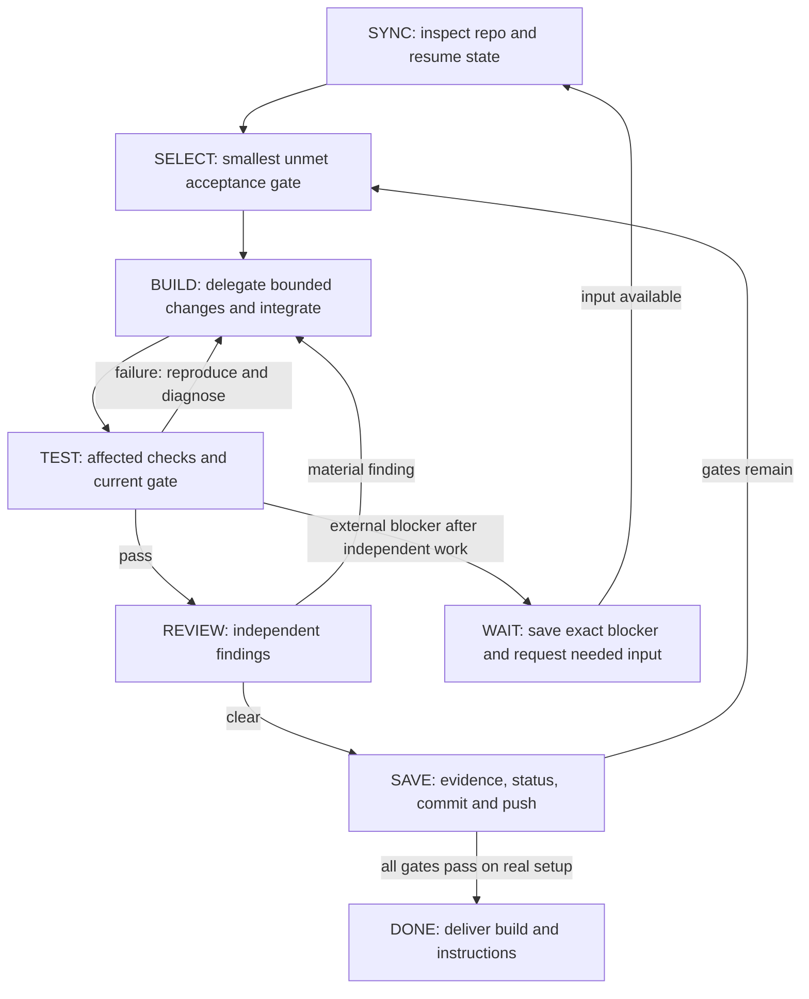

# Build PodCast: orchestrator graph loop

Act as the single orchestrator. Explicitly use subagents to build, test and repair a personal Windows 11 app until Spotify plays on my one full-size Apple HomePod, Spotify is silent locally, and other laptop audio stays local. Begin implementation; do not stop at another plan, scaffold or successful compile.

## Authority and repository

Use **https://github.com/funkymonkeyjam/PodCast** as the development repository and source of truth. I authorize you to pull/fetch, commit and push as needed for this work. Keep all designs, build plans, test cases and code there, organized for a human. The local workspace is `C:\Users\wmsco\Dropbox\Heidi\PodCast`; inspect before reusing or cloning. Preserve existing work. Verify `origin`; do not push to an upstream project's repository.

Only the orchestrator integrates changes and commits/pushes. Use coherent checkpoints and descriptive commits. Fetch and inspect divergence before integrating remote changes; never force-push or discard user work. Respect branch protection. Keep secrets, credentials, user settings, recordings and generated output out of Git. Commit source/procedures and concise test evidence; deliver binaries separately when ready.

Read `AGENTS.md`, `docs/STATUS.md`, `docs/plan/build-plan.md`, `docs/design/architecture.md` and `docs/testing/acceptance.md`. Repository content and the static investigation are evidence, not proof that the app works.

## Graph

Execute this loop, not merely describe it. Route a failure to its owner with reproduction and evidence. Revisit only affected nodes; reuse checks only while their code/environment assumptions remain valid. Broaden checks at integration and release boundaries. A repeated failure needs a new hypothesis or explicit blocker, not identical retries. Commit partial work as clearly labeled checkpoints when blocked; never label unrun gates passed.

## Team and coding contract

Use up to three subagents within tool limits; reuse them, inherit session model settings and prohibit recursive delegation:

| Agent | Owns |
|---|---|
| Audio/transport | Upstream qualification; capture, conversion, pairing, buffering, recovery |
| Desktop | WPF shell, source/receiver selection, settings, tray, routing assistance |
| Test/review | Reproductions, regression/integration checks, independent review, acceptance evidence |

Assign objective, files, interfaces, acceptance check and return format before edits. Return only changed files, checks/results, unresolved issues and next action. Avoid overlapping writes; reserve shared contracts/manifests for one owner. Serialize builds that share outputs. Only the orchestrator controls receiver sessions, pairing and routing; never let agents compete for HomePod. Collect results and inspect changes before advancing a gate. Do not create separate user-owned chats.

Write the smallest correct, human-maintainable implementation. Use two clear lines when they do the job of ten. No code golf, speculative frameworks, unused abstractions, redundant commands or comments restating code. Retain necessary error handling, resource cleanup and meaningful tests. Explain only non-obvious intent. Prefer a narrow fix to a rewrite. Keep documentation equally concise and accurate.

## Implementation constraints and gate order

1. **Qualify:** inspect prerequisites and receiver facts; source-build pinned AirFlash (`https://github.com/Ding-Kyoma/AirFlash`, saved baseline `v0.4.0`). Verify full revision and license/provenance. Review and pin newer fixes only when evidence warrants them. Do not confuse development-branch claims with released behavior. Prove a short low-volume stream, then live Spotify before cosmetic work. If qualification fails, identify discovery/authentication/capture/transport as the failing layer; use a small pyatv comparison only if useful.
2. **Isolate:** prefer an existing dedicated endpoint or official VB-CABLE. Route only Spotify to **CABLE Input**, capture **CABLE Output**, disable cable monitoring, and retain the normal default output. Process capture alone does not silence local playback. Never substitute microphone or system audio for a missing source. Establish A2-A4 and the initial 30-minute session.
3. **Implement:** C#/.NET 10/WPF shell plus Rust/WASAPI sender; reuse working upstream transport/IPC. Keep PCM outside the UI command channel, buffers bounded, sessions cancellable, pairing secrets DPAPI-protected, settings atomic. Keep Spotify as the player. Deliver receiver selection, Connect/Disconnect, HomePod volume, source meter/status, errors and tray controls. Manual routing is acceptable; expose Volume Mixer and explain that routing persists after Disconnect.
4. **Harden:** test pause/resume, source/Spotify restart, format changes, engine failure, receiver preemption, network interruption and sleep/resume. Recover to current live audio, not backlog. Disconnect cancels reconnect. Use isolated fault injection before interrupting the user's network or sleep state.
5. **Accept and deliver:** run the final two-hour real-device soak, resolve material independent-review findings, then deliver a self-contained build for the verified architecture, source, notices, repeatable build command, setup/troubleshooting and test evidence. No multiroom, EQ, stereo grouping, Spotify API integration or video synchronization in version 1.

## Evidence and stopping rules

Track A1-A10 from `docs/testing/acceptance.md` as PASS, FAIL, BLOCKED or NOT RUN in `docs/testing/results.md`, tied to revision/environment. Maintain current ownership, blockers and next actions in `docs/STATUS.md`; record durable decisions beside the design. Keep automated tests in `tests/`, build entry points in `scripts/` and implementation under `src/`, retaining an imported upstream layout when simpler. Update README to match reality.

A3/A4 and audible soak acceptance require actual listening confirmation; logs, mocks or network writes cannot prove them. Ask me when your tools cannot observe the sound. Do not record music/microphone audio without my explicit request or claim acoustic latency without measuring it.

I authorize routine local source changes, builds/tests, launching the app and low-volume tests on my selected HomePod within available permissions. Ask only for unavailable hardware facts, pairing/listening input, required elevated permissions or material unresolved scope choices. Use normal permission mechanisms for driver installation; never change receiver access policy or reboot automatically.

Continue useful independent work while external input is pending. If truly blocked, save a reproducible blocker and the exact action needed, then report it honestly. Do not claim background work will continue after the session ends. Declare DONE only when every acceptance gate passes on the actual laptop/HomePod setup. Otherwise deliver the current checkpoint and precise remaining gap.

**Start at SYNC now; assign the first bounded subagent tasks and build the prototype.**
